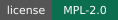

<div align="center">


## LucinaNet

**A self-contained, software-rendered web browser written in Rust.**

<!-- Badges: CI, licence and latest release. These go live with the repository and the first release.
     No verification badge: no CI run is recorded on a public runner yet. -->
<p align="center">
  <a href="https://github.com/gvitolocs/LucinaNet/actions/workflows/ci.yml"></a>
  <a href="https://github.com/gvitolocs/LucinaNet/blob/main/LICENSE"></a>
  <a href="https://github.com/gvitolocs/LucinaNet/releases/latest"></a>
</p>

</div>

## Introducing LucinaNet

LucinaNet is a web browser. It loads a page, lays it out and paints it. Rendering is software by default, and
no system media framework decodes a page's media. The same binary opens a window or writes a page to a PNG,
and the PNG path needs no window.

- **The engine is LucinaEngine.** It is our fork of [Servo](https://servo.org), licensed MPL-2.0. Servo
  gives us the DOM, CSS, layout and painting.
- **We added the browser around it.** Fifteen crates in `crates/`: the window and input toolkit, the
  address bar, session history and its on-disk store, bookmarks, find-in-page, zoom, permissions,
  settings, a block list, keyboard shortcuts, an error log, the accessibility bridge, the media backend
  and the binary itself. Thirteen of the fifteen are in the binary's build (find-in-page is wired into the
  browser window); the block list and permissions are code and tests that nothing calls yet.
- **We replaced the media stack.** `<video>`, `<audio>` and WebAudio run on Rust decoders. GStreamer is not
  used; it does not fit a static build. On macOS the sound sink is CoreAudio, and the media checks run with
  that sink disabled. The Linux build ships without a sound output; the ALSA one is planned for v0.1.1.
- **We changed the software path.** WebRender drives painting. Our own Rust rasterizer in `raster/core` is
  the software path and has been since 2026-11-11; WebRender's C++ `swgl` stays available with
  `LUCINANET_RASTER=swgl`.
- **JavaScript runs in LucinaJS**, a JavaScript engine written in Rust: parser, bytecode compiler and VM, a
  moving garbage collector, and the built-ins including `Intl`. It is our fork of
  [Brimstone](https://github.com/Hans-Halverson/brimstone) (MIT), which is a Rust engine too. The browser
  uses it in place of SpiderMonkey: Servo's script code calls the SpiderMonkey host API, and in this tree
  that API is a Rust crate over LucinaJS. See [LucinaJS](https://github.com/gvitolocs/LucinaJS).
- **The network policy is ours.** The DNS cache lifetime, the socket limits and the TLS stack are set in
  the engine fork's `components/net_policy`. TLS is rustls, and its crypto provider is `graviola`.

### What is not Rust

We say "written in Rust" precisely. These files are compiled into a shipped binary, read from the dependency
manifests and the build scripts of this repository:

- **The allocator.** jemalloc is C. `tikv-jemalloc-sys` builds it from source during the build.
- **`swgl`.** WebRender's software GL backend is C++; `swgl/build.rs` compiles `src/gl.cc` with
  `-std=c++20` in every build, whatever rasterizer a page ends up using. It is linked in and is the
  rasterizer only when you ask for it.
- **The AV1 decoder on aarch64.** We ask for rav1d's `asm` feature under `cfg(target_arch = "aarch64")` only,
  and its build script then assembles hand-written `.S` files through `cc`. On Linux x86_64 the feature is
  off, so rav1d contributes no C, no assembly and no `nasm` run.

Two more compile on the build host and are in no shipped file:

- **`glslopt` and the shader tools.** WebRender's build script compiles the C++ glsl-optimizer the `glslopt`
  crate carries and optimises the shaders with it. Our own build script runs a C preprocessor over the same
  shader text to generate the Rust rasterizer's shaders.
- **The rasterizer's oracle.** C++ test helpers under `raster/core/tests/oracle` are compiled by the
  `oracle` crate, which is a dev-dependency of the rasterizer. They are not shipped.

The font stack is Rust on Linux: skrifa for outlines and zeno for coverage, no FreeType; the vendored glyph
rasterizer makes that substitution. On macOS the same crate asks Apple's Core Text and Core Graphics to draw
the glyphs. The macOS build calls three more of Apple's frameworks: CoreAudio for sound output, Security for
certificate checks and AppKit for the window. All five are system frameworks, so nothing of ours compiles
them and they are in neither list above.

SpiderMonkey is not in the build: the `mozjs` and `mozjs_sys` entries in the lock are our crates, a Rust
implementation of the SpiderMonkey host API over LucinaJS, with no C or C++ source in them. `ring` is C and
assembly; it sits in the lock as an optional dependency of `rustls-webpki`, and the feature that compiles it
is off, so neither build compiles it. The crypto rustls uses there is `graviola`: Rust source with
hand-written x86_64 and aarch64 instructions inside `asm!` blocks, no build script and no C. OpenSSL and
AWS-LC are not in the dependency lock. The release job publishes the libraries each binary actually links,
and that list confirms this one.

## Download

v0.1.0 has not been published, and nothing here is downloadable until it is. A release ships the platforms
that are complete on the day it is cut, and this table lists only the files that release attaches. The release
job prints the size and sha256 of each file in its release notes, and it refuses to publish while a row of
this table names a file the release does not attach or gives a sha256 that disagrees with the built file, so
the size and sha256 cells are filled from those notes when the release goes out.

| Platform | File | Version | Size | sha256 |
| --- | --- | --- | --- | --- |
| macOS arm64 (Apple silicon) | `lucinanet-v0.1.0-macos-arm64.zip` | v0.1.0 (to come) | published with the release | published with the release |
| Linux x86_64 | `lucinanet-v0.1.0-linux-x86_64.tar.gz` | v0.1.0 (to come) | published with the release | published with the release |

**macOS.** The app is ad-hoc signed and not notarized. Apple's document for that case shows an alert at
the first launch of a quarantined download: *Apple cannot check "LucinaNet" for malicious software*, with
the buttons **Move to Trash** and **Done**. Click Done, then open System Settings, click Privacy &amp;
Security, scroll down and click **Open Anyway**. The warning prompt reappears; click **Open**. Apple writes
that the app is then saved as an exception and can be opened by double-clicking afterwards. The document is
[Safely open apps on your Mac](https://support.apple.com/en-us/102445). Not yet tested on a clean Mac.
The launcher of the built app also keeps the run's own logs on the Mac: when it can create
`~/Library/Logs/LucinaNet` it turns the page console on, appends everything the engine prints during that
start to `session-<time>.log` there, and lets it record missing JavaScript features and uncaught page errors
to `missing-<time>.log`; both are written to that folder only, and the launcher sends nothing of them
anywhere.
On the macOS arm64 asset: on this build and the previous one, a YouTube video can stop at about 40
seconds and needs a reload; the cause is under investigation.

**Linux x86_64.** No sound output yet: video plays without sound; the ALSA output is planned for v0.1.1.
Minimum glibc: 2.35, which is Ubuntu 22.04. A start test ran under a virtual X server on a muted page
from a local file: the binary started on Ubuntu 22.04, Ubuntu 24.04, Debian 12 and Fedora 45, the page
rendered to the same PNG on all four, and each window start was alive after 5 s. A run on a real desktop
has no date yet. The window opens through X11, so a Wayland desktop runs it through XWayland;
a Wayland-only session has not been tested. The four shared libraries the binary links besides the dynamic
loader — `libc.so.6`, `libm.so.6`, `libstdc++.so.6` and `libgcc_s.so.1` — were present in each image it
started on. The X11 client libraries are the rest, and the window toolkit loads them at run time, so they
are not in the binary's `ldd` output. The X11 package names below are the ones that measured run on those
four images needed, not a hand-derived mapping: with only them on bare Fedora the window start panicked
until `libX11-xcb` was installed, and that bare start was not run on the Debian-family images. The
ALSA row is not needed by this file and is not measured: nothing in the build opens ALSA, because the
crate that reaches the platform's audio device is attached to macOS builds only.

| What the binary loads at run time | Debian and Ubuntu | Fedora |
| --- | --- | --- |
| The X11 client libraries the window toolkit opens | `libxcursor1`, `libxi6`, `libxkbcommon-x11-0`, `libx11-xcb1` | `libXcursor`, `libXi`, `libxkbcommon-x11`, `libX11-xcb` |
| The ALSA runtime, for the sound output of v0.1.1: not needed today | `libasound2` | `alsa-lib` |

**Fonts.** The browser has no fontconfig. It searches a fixed list of system directories, or the ones
`LUCINANET_FONT_DIRS` names. The Linux tar carries its own fonts so that it needs neither: three DejaVu
faces in `share/lucinanet/fonts`, beside `bin/`. Keep that folder where the tar puts it. Without those
three faces the window does not open, and a headless render draws no text.

### Planned

- **Linux aarch64.** Planned, and no asset in v0.1.0. It needs a run on real arm64 hardware, a CI job and a
  release file.
- **Windows x86_64.** Builds run on pushes to main that touch the crates or `Cargo.lock`, weekly and on
  manual dispatch; the jobs are allowed to fail and list their blockers, and no file exists yet.
- **Android arm64.** Builds run on the same pushes, weekly and on manual dispatch; the jobs are allowed to
  fail and list their blockers, and no file exists yet.
- **iOS.** No build exists and none is promised. iPhone and iPad install apps from the App Store. Apple
  allows alternative app marketplaces in Brazil, Japan and the European Union, and distribution from a
  developer's own website in the European Union
  ([Apple](https://support.apple.com/en-us/117767)). A browser that ships its own engine needs Apple's Web
  Browser Engine Entitlement, granted for apps distributed in the European Union and against a conformance
  bar on Web Platform Tests and test262
  ([Apple](https://developer.apple.com/support/alternative-browser-engines/)). This page publishes no score
  against that bar.

## Getting started

Build from source on Linux x86_64 or macOS arm64. You need a C and C++ toolchain (`clang` and `clang++`),
`make` and a POSIX shell, because the allocator configures and builds itself with `sh configure` and `make`,
and `python3`, which the codegen scripts of the engine and of the CSS style engine run. You also need the Rust
toolchain this repository pins in `rust-toolchain.toml`: 1.99.1, which is
`rustc 1.99.1 (58cf8f9c3 2026-10-13)`.

```sh
git clone https://github.com/gvitolocs/LucinaNet
cd LucinaNet
CC=clang CXX=clang++ PYTHON3=python3 cargo build --release -p lucinanet-servo --features desktop,media
```

The two features do the work. `desktop` pulls in the window toolkit; without it there is no window.
`media` installs the media backend; without it a page says it cannot play the video. `--release` is the
profile the release job builds the released file with. `--profile probe` builds faster (opt-level 2, no LTO),
and is the profile CI builds with and the scripts in `scripts/` use.

```sh
target/release/lucinanet-servo --desktop https://example.com
```

`--render` (load one page and write a PNG, with no window) is not in this build: a normal build refuses it as
an unknown option. It exists only in the test and measurement build, which carries the cargo feature
`harness` and is never shipped (`docs/harness-doors.md`). Build and run that one with
`tools/build-harness.sh --run`, which prints the command and the path of the binary, then:

```sh
tools/build-harness.sh --run
<printed binary path> --render https://example.com out.png 1280x800
```

Build time on an 8-core x86_64 machine with 32 GiB of RAM: not measured yet. Disk under `target/`:
not measured yet.

## How it is built

One repository holds everything the build needs, plus crates.io. `crates/` is our code; `swgl/` and
`raster/` are ours at the top level; the engine fork, WebRender, the glyph rasterizer, the JS engine glue,
the JavaScript engine, the CSS style engine and the AV1 decoder are vendored under `third_party/` and `js/` as
path dependencies, not fetched. `third_party/UPSTREAMS.toml` names each upstream, the commit it is based
on, what we changed and its licence, so any directory can be diffed against its upstream.
`rust-toolchain.toml` pins the compiler to 1.99.1.

`.github/workflows/ci.yml` is the CI: it runs on every push to main and on every pull request, and one
aggregate check passes only when every job did. The jobs are the rustfmt ratchet against a
baseline (the clippy ratchet starts when its baseline exists), a build of the browser in the probe profile and `cargo test` of our crates on Ubuntu and on macOS
arm64, a `--render` of a local page checked against a blank one, three media pages that print their own PASS line
(the media trace checker runs only on its own tests), the out-of-memory pages, the crates that stand outside the browser, and one
Verus proof unit per runner. Two further workflows try a Windows and an Android build on the triggers named
under "Planned" and let them fail, so the job summary lists their blockers. The workflow files are written;
no run of theirs is recorded on a public runner, and the first green run has no date. The acceptance README,
`tests/acceptance/README.md`, records one known element-contract finding on local variants.

## Verification

These suites in `tests/` run against the built binary or the renderer:

- `crash/` — the pages and stress recipes that used to crash the JS engine, run headless against live sites.
- `css/` — stylesheet mutation: inserting and mutating rules, at-rule objects, `@property` registration.
- `edge-wrap/` — three pages that fill a capped JS heap at three different engine entry points; the run must
  end with an out-of-memory record and exit 0, not a crash.
- `fonts/` — glyph coverage pages, a CJK and emoji page, and a count of the characters drawn as tofu.
- `media/` — MP4 and WebM video, MP3 audio, Media Source Extensions, WebAudio, scaled planes, and a check
  that a run with the audio sink disabled produces no sound.
- `profile/` — a cookie, a localStorage key and an IndexedDB value written by one run and read back after a
  restart.
- `sweep/` — a committed list of 100 web sites, rendered headless, scored against marker data for known
  failure modes.
- `web/` — checks against real pages, a content-security-policy origin check and a busy-scroll check.

`verification/` holds inputs to the Verus verifier: one over the accessibility rules of the engine fork,
plus two models and a mutants script. `scripts/verify.sh` runs them with the version pinned in
`verification/verus.version`, and CI runs one unit per runner under a memory cap. No unit of theirs has run
on a public runner, so this page makes no claim about their results.

## Status

Works:

- Page loading, layout and painting to a PNG, headless, on Linux x86_64. The software rasterizer is the
  default since 2026-11-11.
- A desktop window on macOS arm64, with a page in it. The input check on it has no date yet. On
  Linux x86_64 the window opens and draws under a virtual X server, checked on Ubuntu 22.04, Ubuntu 24.04,
  Debian 12 and Fedora 45; a real desktop run has no date yet. The window closes from the window manager.
- Video: H.264, AV1 and VP9 on the CPU. Audio: AAC, MP3, Vorbis, FLAC, ALAC, PCM. Media Source Extensions
  and WebAudio. The decoders are in the macOS and the Linux build, and the macOS build carries the CoreAudio
  sink. The media checks in `tests/` run with that sink disabled. Video and audio playback on macOS arm64 is
  being verified for v0.1.0, and that verification has no date yet. On the macOS arm64 build and the
  previous one, a YouTube video can stop at about 40 seconds and needs a reload; the cause is under
  investigation. Not measured on Linux beyond two 110 s runs.
- JavaScript runs in LucinaJS on our Brimstone fork. It is interpreter-first and has no JIT, and the
  `js_jit` build feature changes nothing in this tree.
- Session history with back navigation, bookmarks, zoom, settings and an error log. The address bar
  completes from history and bookmarks.

Does not work:

- **No DRM video.** Encrypted Media Extensions are not implemented, so a page that needs a key system does
  not play. This is a decision, not a defect.
- **No H.265.** It decodes only on a hardware video block, and neither build uses one.
- **No VP8 video and no Opus audio yet.**
- **No Windows or Android build**, and no extension API, syncing or autofill.
- **No block list or permission prompts in the browser.** The two crates are written and tested; nothing
  calls them yet. Find-in-page works: `lucinanet-ui` calls `lucinanet-find`.
- **The JS engine is experimental.** Web content is untrusted input.

Open defects:

- The macOS app is ad-hoc signed, so the first launch needs the override above. Developer ID signing and
  notarization are not in place.
- The Linux tar is sure of only the three DejaVu faces it carries. They hold no CJK and no emoji glyph, so
  those characters show only when the machine has a system font in one of the directories it searches.

Not yet measured:

- **Ctrl+Q** asks for the same exit as closing the window: the key map and its test cover it. Measured on
  the four images it exits within 150 ms, under Xvfb, with a synthetic xdotool key; a real desktop run has no date.

## Licence

LucinaNet's own code is MPL-2.0: the workspace declares it in `Cargo.toml`, and `LICENSE` holds the full
text of the [MPL-2.0 license](https://www.mozilla.org/en-US/MPL/2.0/). One crate is MIT, `tools/sitecheck`.
The logo files under `assets/logo/` are MIT too, not MPL-2.0: the name and the mark are what identify the
project, so their licence text is not a file of its own. It travels in the `README.md` beside them. `NOTICE`
names every upstream, the commit it came from and what we changed.

Upstream terms stay with the upstream code. Each vendored directory keeps its own licence file and headers:
the engine fork, WebRender and the CSS style engine Stylo are MPL-2.0, and the fork carries Servo's
`LICENSE_WHATWG_SPECS` for specification text under BSD-3-Clause; LucinaJS is MIT, and the `LICENSE` that
travels with it names Hans Halverson as the copyright holder; the `mozjs` bindings and the Rust SpiderMonkey
host API over it are MPL-2.0 with Mozilla's headers, and no SpiderMonkey source is in the build; the `Intl`
built-ins run on ICU4X, whose baked locale data is under the Unicode License v3; the crates we take from
LucinaOS, an operating system project of ours, are MIT, or MIT-compatible as each crate states; the Linux tar
ships three DejaVu fonts and their licence file in `share/lucinanet/fonts/`; and the decoders are
BSD-2-Clause, BSD-3-Clause, MIT, Apache-2.0 or MPL-2.0 as each crate states. Some numbers come from other
browsers: where we ported behaviour from Firefox or Chromium, the crate that holds it says so in its own
`NOTICE` file. Four crates do — `lucinanet-omnibox`, `lucinanet-permissions`, `lucinanet-shortcuts` and
`lucinanet-zoom` — and the Chromium parts are BSD-3-Clause, which is the licence text each of those notices
copies. Three of them carry further parts derived from Firefox: `lucinanet-shortcuts` a table,
`lucinanet-omnibox` URL fix-up rules, scheme typos and autofill rules, and `lucinanet-zoom` four named files;
each of those three notices names the parts it holds and gives their licence, MPL-2.0.

Copyright 2026 **LucinaNet contributors**.
